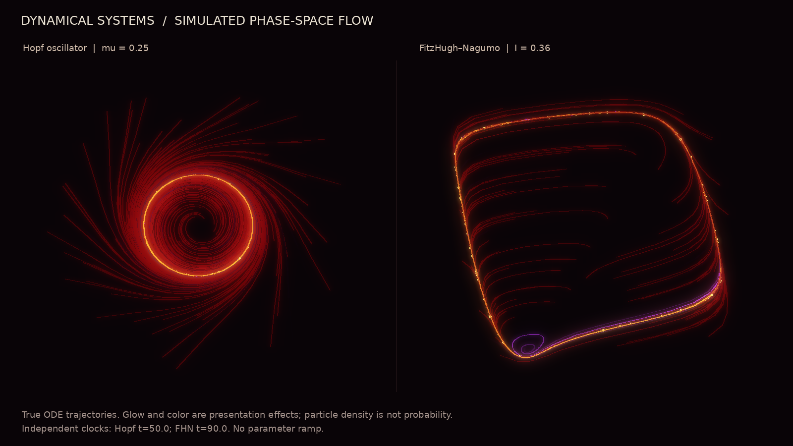
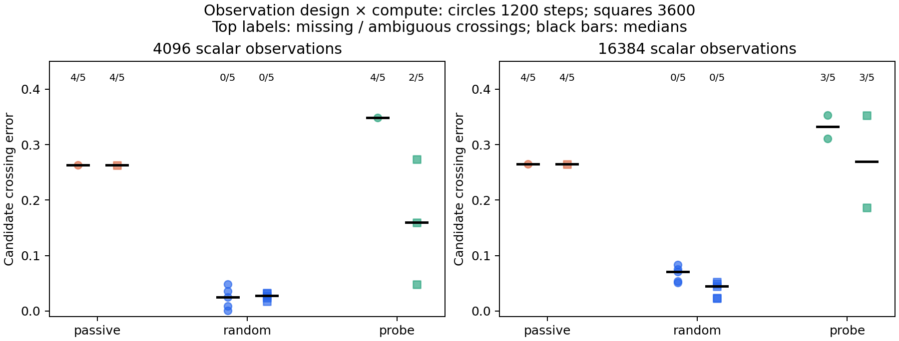
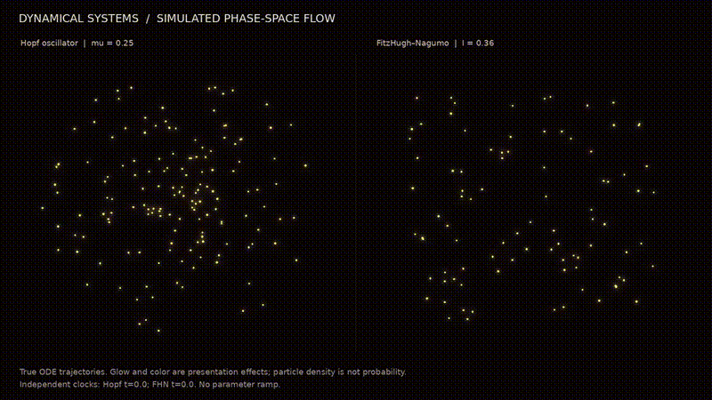
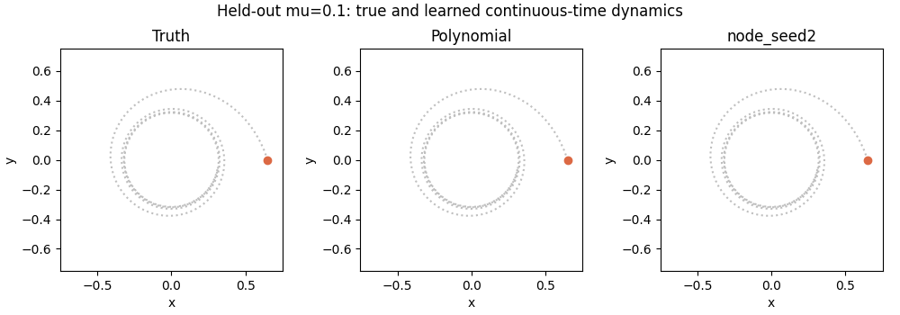

# Beyond Orbit Fit

**Observation Geometry and Structural Priors in Learning Hopf Bifurcations**

Original computational research by **Jiajun Fu, Duke Kunshan University**.

[Read the paper](paper/manuscript.pdf) · [Interactive demo](demo/index.html) · [Rendered video](phase4/rendered_phase_flow.mp4)

## Research question

Can learned differential equations recover bifurcation locations, stability and attractors from finite observations? Which observation designs and declared priors help at matched measurement budgets?

## Findings

- Passive orbit data retain rank 11/13 even after quadrupling observation count.
- Random transients give unique candidate NODE crossings in all five main-comparison seeds at both budgets.
- Tiny probes work well with a correct dictionary without noise, but become noise sensitive.
- Larger probes improve selected NODE controls; acquisition and model prior interact.
- Five FHN NODEs numerically preserve subcritical type while shifting location.
- Twenty-one periodic shooting points pass tolerance refinement.

## Animated demonstrations

## Quick start

Python 3.12 was used. Install the pinned packages, then verify saved evidence:

    python -m pip install -r requirements.txt
    python reproduce.py verify

Open demo/index.html directly in a browser. The standalone HTML embeds actual saved weights and needs no network or server. Both panels use the same initial particles. Parameter changes restart time. Node.js, if available, enables the additional DOM-mock functional tests; browser visual QA was not performed in the build environment.

## Reproduction

    python reproduce.py reference
    python reproduce.py full
    python reproduce.py paper

Full mode regenerates experiments and overwrites generated evidence in this checkout; use a separate checkout to preserve a release. Runtime is several minutes or longer depending on CPU.

Paper mode requires pdflatex and the packages listed in manuscript.tex; the saved PDF requires no LaTeX installation. Video generation requires ffmpeg with libx264. Training needs no GPU or PyTorch.

## Contents

| Path | Contents |
|---|---|
| paper/ | English manuscript, LaTeX, generated tables and PDF |
| demo/ | Self-contained interactive true-versus-learned simulation |
| learning_core.py | Neural field, RK4 backpropagation and diagnostics |
| phase0/ | Research protocol and analytic ambiguity |
| phase1/ | Reference equations, data, checks and animations |
| phase2/ | Initial trained models and results |
| phase3/ | Matched-budget data designs and complete seed results |
| phase4/ | Robustness, FHN, Hopf coefficients, periodic orbits and renders |
| tests/ | Gradients, Jacobians, budgets, evidence integrity and demo checks |
| reproduce.py | Root verification and regeneration commands |
| CITATION.cff | Citation metadata |
| RELEASE_NOTES.md | Final validation and scope |

## Scope

These are conditional synthetic findings, not a new NODE architecture or universal sampling rule. Radial acquisition assumes oracle anchors and excludes setup costs. Noisy NODE controls use clean validation. Longer windows change sampling and segment duration. Convergence is not proven. Replication is limited. The correct polynomial dictionary is a strong prior. Selected local periodic points do not constitute a global bifurcation diagram.

Failures and reversed crossings remain in the evidence. Conditional medians must be read with failure counts. Glow and particle density are presentation effects, not uncertainty or energy.

The original manuscript includes an AI-assistance statement and prior-work references; it is not a peer-reviewed publication.

## GitHub metadata

Suggested name: **bifurcation-learning**.

Description: Reproducible experiments on how observation geometry, noise and structural priors affect Hopf bifurcation recovery, with neural ODEs, periodic-orbit diagnostics and interactive visualizations.

All six planned phases are complete. Repository: https://github.com/Fjj040806/bifurcation-learning
